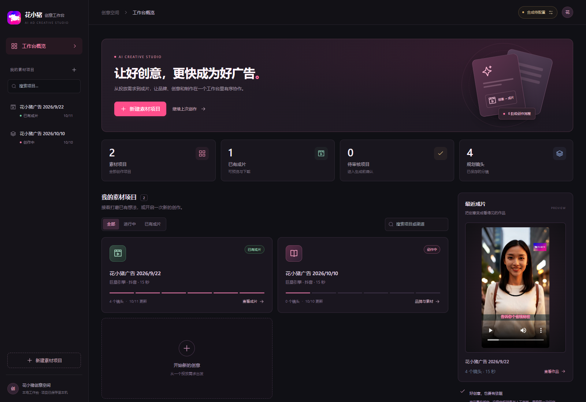
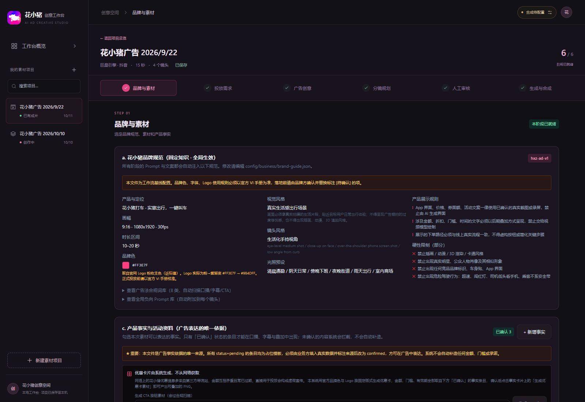
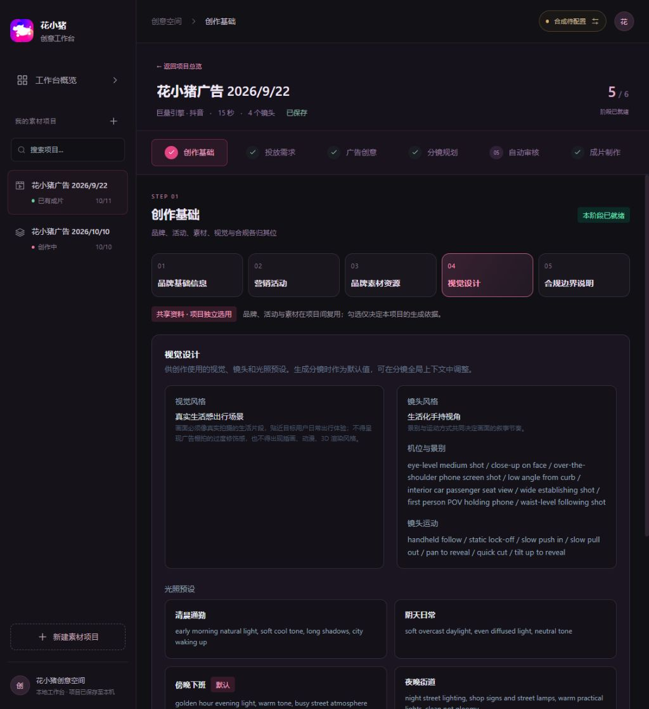
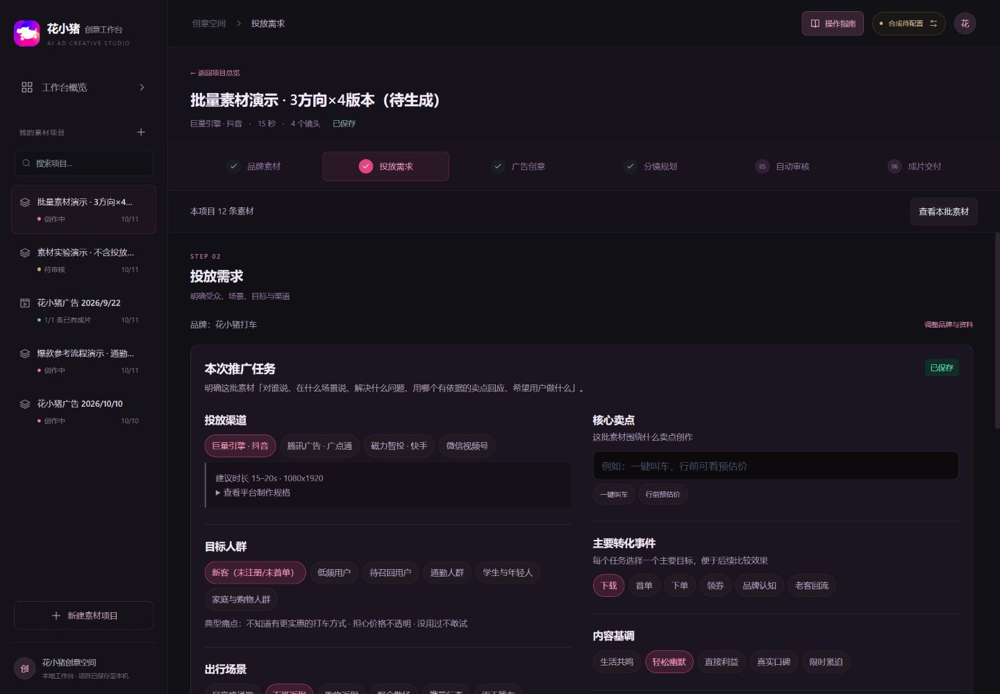
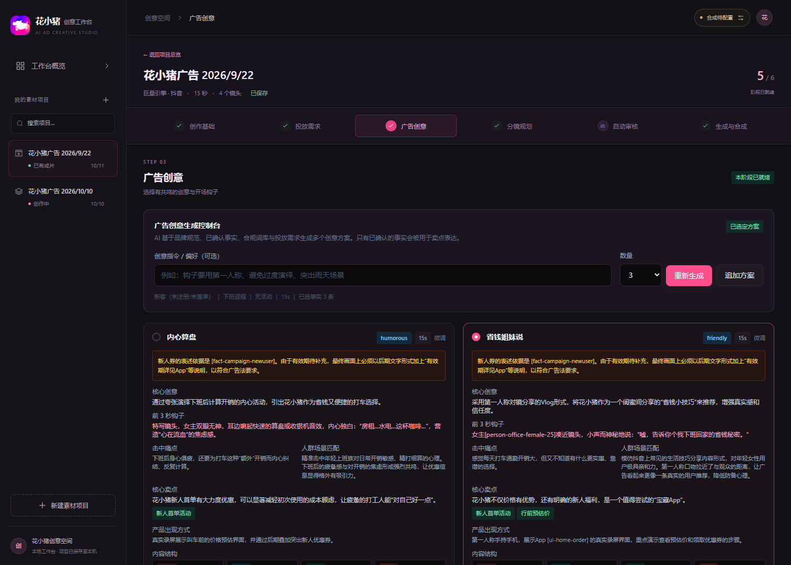
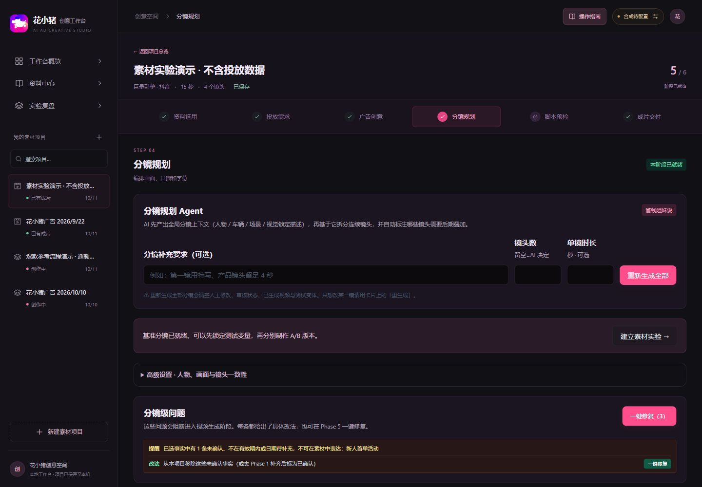
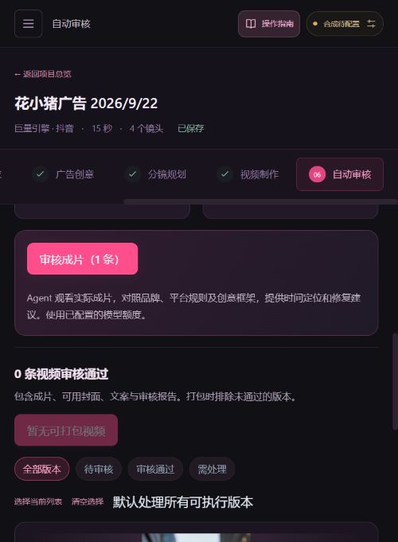
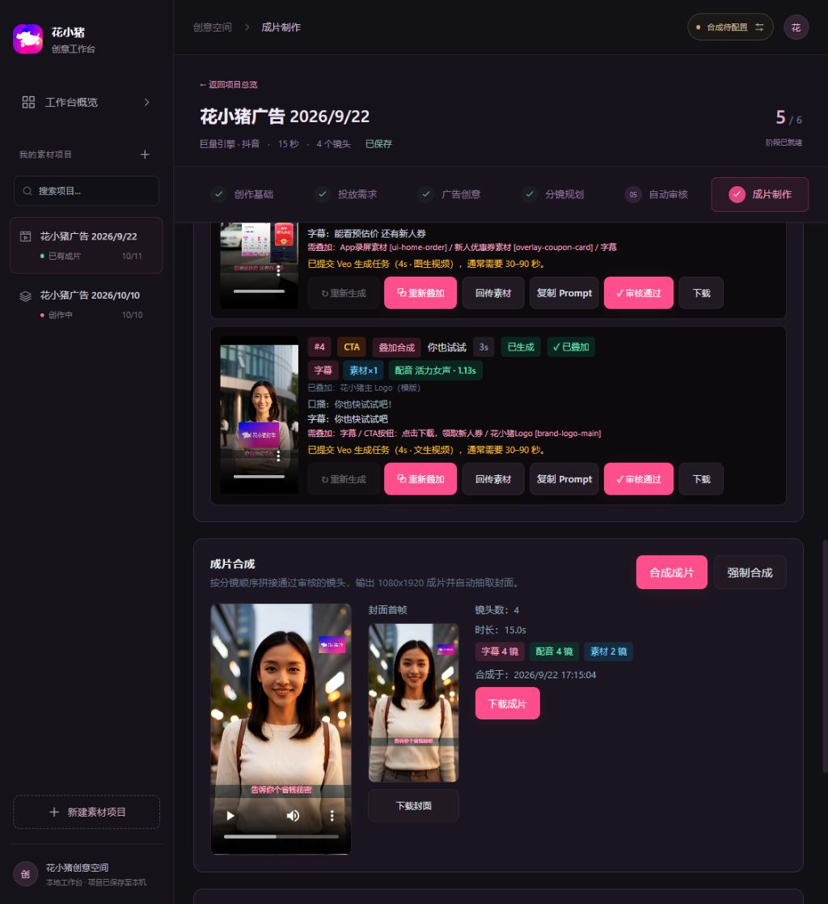

# AI Ad Creative Workbench

[简体中文](README.md) · **English**

**An AI workspace for turning advertising briefs into creative concepts, storyboards, reviewed shots, and finished vertical videos.**

### Full workflow recording: create a 15-second ad from scratch

Follow one project in about 3 minutes: **facts and assets → brief → concepts → storyboard → automatic review and repairs → video generation → narration and assembly → playback and download**. Chinese step explanations and click indicators accompany the actual interactions.

https://github.com/user-attachments/assets/ea7da458-9990-423d-b896-ad58b3098b28

[Download the recording (MP4, about 7.3 MB)](assets/demos/workbench-workflow.mp4) · [Steps and chapters](docs/walkthrough.md) · [Watch the resulting 15-second ad](assets/demos/workflow-result.mp4)

> Recorded from a new project with actual model calls for concepts, storyboards, first frames, and video shots. It includes corrections and rechecks after review findings. Model and download waits are shortened. The interface recording uses text explanations; the ending includes the generated ad with its original audio. This demonstrates the workflow; generated visuals and asset versions still need review before an actual campaign.

The home-screen **“90 秒了解流程”** button and the top-bar **“操作指南”** also provide a replayable 12-step bubble tour. That separate tour uses an isolated example without editing saved projects or calling models. [Tour guide](docs/guide.md).

This project uses a Huaxiaozhu ride-hailing campaign as its example workflow, focusing on 10–20 second vertical ads. Screenshots come from the running application. Local projects, uploaded files, and generated videos are excluded from Git. The repository includes the workflow recording, its resulting demo ad, a fixed tour example, and a compressed historical sample ad; a fresh installation still starts with no saved projects.

[Features](#features) · [Quick start](#quick-start) · [Configuration](#configuration) · [Deployment](#deployment) · [Project structure](#project-structure)

## What it does

Keep the brief, creative decisions, prompts, assets, reviews, and rendering results together in one project.

- Track projects, resume creation, and preview recent outputs.
- Turn audience, scenario, selling points, and calls to action into editable concepts and storyboards.
- Reference product facts and brand assets throughout the workflow.
- Generate or import shots, add subtitles and audio, and assemble videos and covers.
- Prepare variants that change one creative dimension while documenting the hypothesis and affected shots.

Channel presets include Douyin, Tencent Ads, Kuaishou, and WeChat Channels. The application supports **creative production**; it does not currently publish to advertising accounts, manage budgets, or import campaign performance.

## The six-stage workflow

| Stage | Purpose | Output |
| --- | --- | --- |
| 01 Creative foundation | Organize brand identity, campaigns, assets, visual design, and compliance | Five distinct input areas |
| 02 Advertising brief | Define audience, scenario, channel, duration, and CTA | Structured brief |
| 03 Creative concepts | Compare directions and opening hooks | Selected concept |
| 04 Storyboard | Plan visuals, narration, subtitles, and timing | Editable shot cards |
| 05 Automatic review | Check a project checklist, repair eligible issues, and recheck | Evidence, changes, and missing inputs |
| 06 Video production | Produce shots, assemble the video, and prepare variants | Video, cover, and creative package |

## Features and real screens

### Five clear areas for creative inputs

Separate brand positioning, colors, logos, and selling points from campaign benefits and eligibility. Keep existing material categories in the asset library. Visual design contains style, camera, lighting, and production presets. Compliance boundaries bring wording and material rules together. Shared libraries retain project-specific selections.

### A structured advertising brief

Specify the audience, scenario, objective, tone, duration, and CTA. Channel guidance helps account for vertical layouts, subtitles, and interface overlays.

### Compare creative directions before production

Generate multiple concepts, inspect their hooks and supporting facts, refine a direction, and select it for storyboarding.

### Editable shots and shared visual context

Record character, vehicle, scene, and style descriptions once, then manage individual shots. Each card includes its role, prompt, voiceover, subtitle, duration, and asset references.

| Rendering mode | Use |
| --- | --- |
| `ai` | Model-generated scenes and actions |
| `overlay` | Generated footage with programmatic text and asset overlays |
| `asset` | Existing approved material, such as a product recording |

Reference images and shared descriptions help guide consistency; outputs still need visual review.

### Checklist-based automatic review and repair

Save 1–30 requirements per project. A rule engine checks facts, wording, assets, rendering choices, and narration length. The agent evaluates each requirement and may apply one bounded round of text repairs followed by a fresh review. Approval requires zero rule blockers and a complete passing checklist. Missing credentials, model failures, and incomplete evidence never produce automatic approval. Changes to inputs invalidate previous results; campaign information is rechecked on a new day. This stage reviews pre-generation storyboards and references, not rendered video pixels.

### Video assembly, export, and creative variants

Generate, import, or retry individual shots. With FFmpeg configured, combine footage, subtitles, brand assets, and voiceover into a 1080 × 1920 video and extract a cover image. Prepare variants around one creative dimension and record the changed and reused shots.

The creative package download is a **JSON file**, containing the brief, concept, fact references, shared context, shot prompts, and variant information. Download video and cover files through their separate controls.

## Quick start

### Requirements

- **Node.js 22 or 24**, including npm. The package requires Node.js 20.19 or newer.
- **FFmpeg** for local video composition, subtitle overlays, and Mock video clips.
- **A Chinese font** for the sample's Chinese subtitles.
- **Model credentials**, optional when trying the Mock workflow.

~~~bash
git clone https://github.com/maipeici/xhs-ai-creative-workbench.git
cd xhs-ai-creative-workbench
npm ci
~~~

Create your local configuration in PowerShell:

~~~powershell
Copy-Item .env.example .env
~~~

Or on macOS / Linux:

~~~bash
cp .env.example .env
~~~

Keep the credentials blank to start in demonstration mode. If `.env` already exists, edit it instead of overwriting it.

~~~bash
npm run build
npm start
~~~

Open **http://localhost:8787**.

On Windows, after installing dependencies, you can also double-click **`scripts/start-workbench.cmd`**. It builds and starts the application when a service is not already running, then opens the browser. The launcher reads `PORT` from the application configuration.

### Create your first project

1. Create a project, upload your own assets, and verify the product facts.
2. Fill in the brief, generate concepts, and select a direction.
3. Create a storyboard and check each shot's timing, narration, and references.
4. Resolve blocking issues and complete the human review.
5. Generate or import footage, assemble the video, and download the output.

Without model credentials, text generation uses Mock data and image previews use placeholders. Mock videos are solid-color timing clips when FFmpeg is available. Without FFmpeg, video generation returns a simulated status without producing a file.

## Configuration

Copy [`.env.example`](.env.example) to `.env` and keep credentials server-side. The server resolves this file from the repository root, even when launched from another directory. Existing environment variables take precedence. Restart after changing configuration.

**Never expose model credentials through `VITE_*` variables or frontend source files.**

| Capability | Environment variables |
| --- | --- |
| Google service account | `GCP_PROJECT_ID`, `GCP_CLIENT_EMAIL`, `GCP_PRIVATE_KEY`, `GCP_TOKEN_URI` |
| Vertex AI models | `VERTEX_LOCATION`, `VERTEX_GEMINI_MODEL`, `VERTEX_IMAGE_MODEL`, `VERTEX_VEO_MODEL` |
| Compatible text API | `LLM_BASE_URL`, `LLM_API_KEY`, `LLM_MODEL` |
| Compatible image API | `IMAGE_BASE_URL`, `IMAGE_API_KEY`, `IMAGE_MODEL` |
| Custom video gateway | `VIDEO_MODE=http`, `VIDEO_API_URL`, `VIDEO_API_KEY`, `VIDEO_MODEL`, `VIDEO_STATUS_URL` |
| Local composition | `FFMPEG_PATH`, `SUBTITLE_FONT` |
| Voiceover | `TTS_ENABLED`, `TTS_VOICE`, `TTS_AMBIENT_VOLUME`, `TTS_VO_VOLUME` |

Place the private key in double quotes and preserve its `\n` line-break escapes. The service account needs permission to use the configured APIs, with billing and quota available. Template model names are examples; check availability for your own account and region.

Vertex is preferred for text and image generation when its credentials and all three model fields are configured. Otherwise the compatible APIs are used when configured. Text API failures can fall back to Mock data.

Compatible base URLs should stop at the API root, such as `/v1`. The application appends `/chat/completions` or `/images/generations`. For an asynchronous custom video API, `VIDEO_STATUS_URL` must contain `{id}` for the task ID. Adapt gateway fields in [the video provider](src/server/providers/video.js) when necessary.

| `VIDEO_MODE` | Behavior |
| --- | --- |
| Empty | Automatically choose Vertex, then a custom video gateway, then Mock |
| `vertex` | Vertex video generation |
| `http` | Custom video gateway |
| `manual` | Generate externally and import the result |
| `mock` | Placeholder clips; FFmpeg is needed to create actual video files |

FFmpeg must support `libx264`, `aac`, and `drawtext`. On Windows, a typical font path is `C:/Windows/Fonts/msyh.ttc`. On Linux, configure an installed Chinese font, such as `/usr/share/fonts/opentype/noto/NotoSansCJK-Regular.ttc`. Google Cloud TTS uses the configured Google service account.

More detail is available in the [configuration guide in Chinese](docs/configuration.md).

## Development and deployment

~~~bash
npm run dev
~~~

The development page runs at **http://localhost:5173**. Vite proxies `/api` and `/media` to port 8787. If you change the backend development port, update [the Vite proxy](config/vite.config.ts) too.

For a server installation:

1. Install Node.js, FFmpeg, and an appropriate font.
2. Run `npm ci` with development dependencies included.
3. Configure `.env` for that environment.
4. Run `npm run build` followed by `npm start`.
5. Use a process manager and persist the application data.

The Express server serves the built frontend. Hosting only `dist/` is insufficient for the complete application. This is a single-instance application backed by local JSON and media files, with no built-in login, team permissions, or tenant isolation. Use authentication, HTTPS, and network access controls before making it accessible beyond a trusted environment.

The [deployment guide in Chinese](docs/deployment.md) includes a Linux systemd example, upgrade steps, and troubleshooting.

### Data persistence

| Directory or file | Purpose | Committed |
| --- | --- | --- |
| `.env` | Private credentials and local configuration | No |
| `.env.example` | Safe configuration template | Yes |
| `data/seed/` | Default asset presets and fact templates | Yes |
| `data/runtime/` | Projects, edited assets and facts, uploaded/generated media | No |
| `config/business/` | Brand, channel, and validation rules | Yes |
| `assets/` | UI assets and README screenshots | Yes |

On first launch, missing runtime files are initialized from the seeds. Existing runtime data is preserved on subsequent launches. Back up the entire `data/runtime/` directory, your `.env`, and any customized business configuration.

When upgrading from the original layout, stop the application and back up the old `data/` directory first. Before starting the updated version, put its project, asset, and fact JSON files and `media/` folder into `data/runtime/`. Move custom brand/channel/compliance configuration into `config/business/`. Compare files before merging if both locations contain data.

## Project structure

~~~text
src/
  client/                 React application and styles
  server/                 API, model providers, validation, storage
assets/
  public/brand/           UI icons and logos
  public/demo/            Compressed sample ad for the tour
  demos/                  README walkthrough video and cover
  screenshots/            Product screenshots
config/
  business/               Brand, channel, and validation rules
  vite.config.ts          Build and development configuration
  tsconfig.json           TypeScript configuration
  tailwind.config.js      Theme and CSS discovery
  postcss.config.js       CSS processing
data/
  seed/                   First-run defaults
  runtime/                Private runtime data; ignored by Git
docs/                     Deployment, configuration, contributors
scripts/
  start-workbench.cmd     Windows launcher
  start-workbench.ps1     Build and startup implementation
tests/                    Environment and data initialization tests
~~~

React, TypeScript, Vite, and Tailwind CSS power the frontend. Node.js and Express power the backend. Sharp handles image processing, and FFmpeg handles video composition.

Use npm consistently; `package-lock.json` is the dependency lock file.

~~~bash
npm test
npm run typecheck
npm run build
~~~

## Contributors

Maintained by [maipeici](https://github.com/maipeici), with AI development assistance from OpenAI Codex. See [the contribution notes](docs/CONTRIBUTORS.md).
