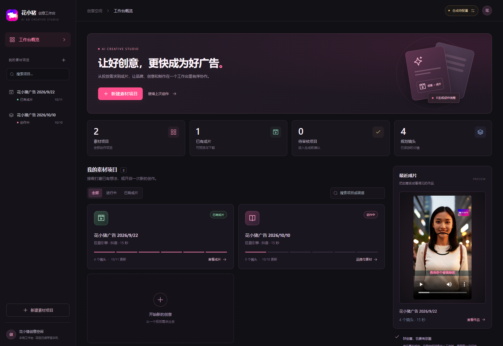
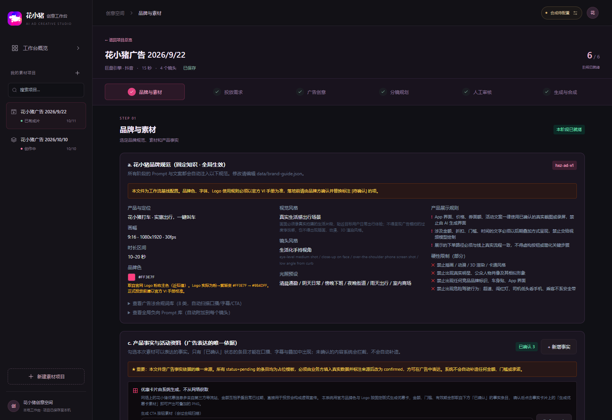
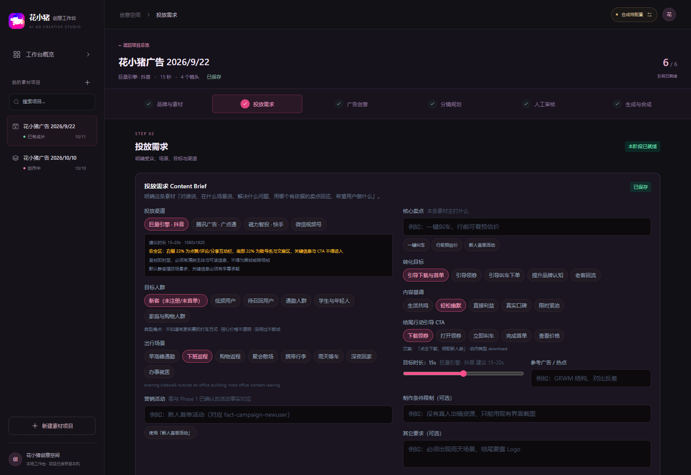
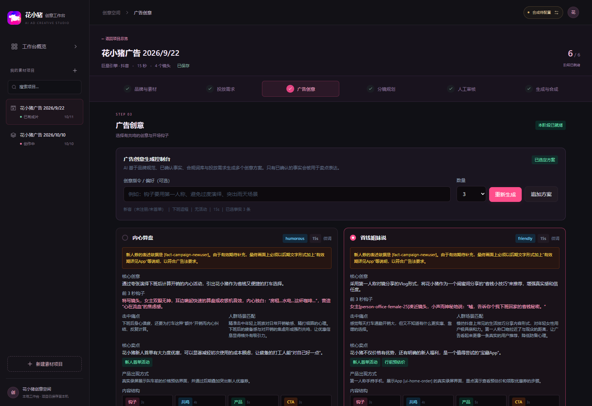
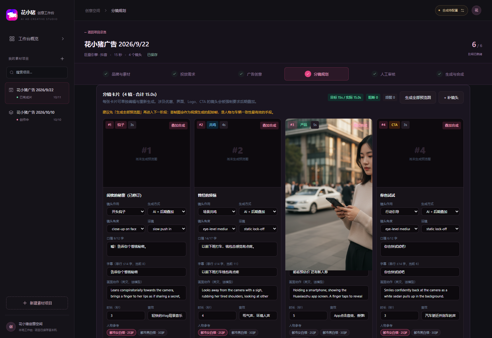
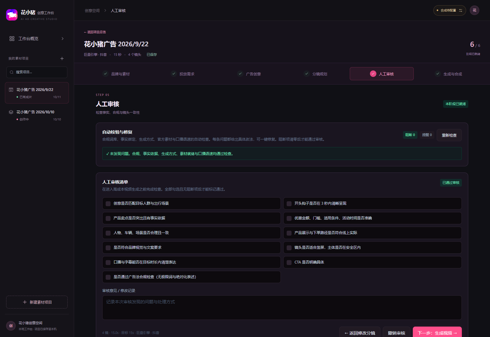
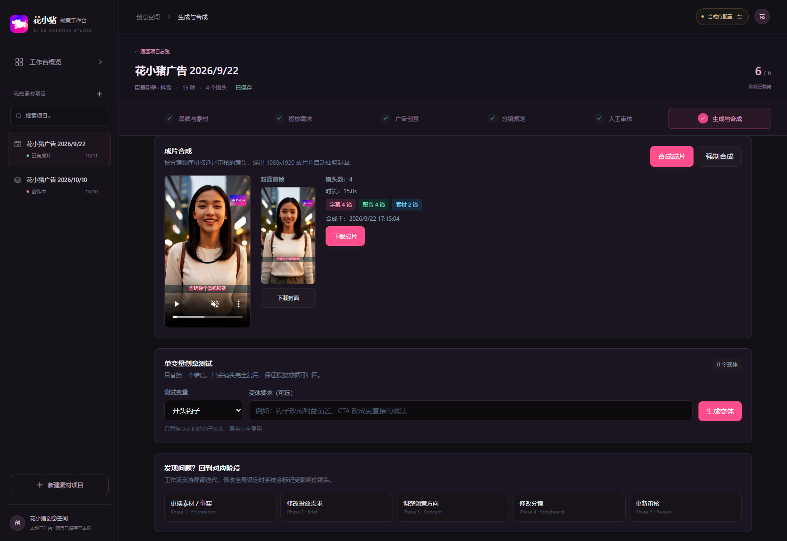

# AI Ad Creative Workbench

**AI 广告创意与素材制作工作台：从投放需求出发，把创意、分镜、审核与视频制作串成一个可回看的流程。**

> 当前以花小猪出行广告为案例，面向 10–20 秒竖屏信息流素材创作。以上及下方图片均截取自实际运行的工作台；示例项目、上传素材和生成视频保留在本地，新安装的工作台从空项目开始。

[功能与页面](#features) · [快速开始](#quick-start) · [模型配置](#model-config) · [部署与运行](#deployment) · [常见问题](#faq)

## 这个工作台能做什么

把分散在需求文档、提示词、素材文件和视频工具里的创作过程放进同一个项目。每一步保留上下文，方便回看、修改与继续制作。

- **管理创作项目**：查看项目进度、搜索素材项目、继续上次创作、预览最近成片。
- **将需求变成可执行分镜**：从受众、场景、卖点和行动引导，逐步生成创意方向与镜头卡片。
- **让素材制作有依据**：关联产品事实与品牌素材，检查文案、镜头生成方式和口播时长，再进入人工审核。
- **完成生成与交付**：生成或回传镜头，叠加字幕、素材与配音，合成视频，下载成片、封面和结构化创作包。
- **准备单变量测试素材**：围绕开头钩子、CTA 等维度创建创意变体，记录修改范围与测试假设。

渠道配置包含抖音、腾讯广告、快手和微信视频号的素材要求与安全区提示。当前项目负责素材创作，**尚未接入广告账户发布、预算管理或投放效果回传**。

## 六个阶段，一条创作路径

| 阶段 | 在工作台中完成的事 | 主要产出 |
| --- | --- | --- |
| 01 品牌与素材 | 选取品牌规范、参考素材和已确认产品事实 | 创作依据与素材引用 |
| 02 投放需求 | 明确渠道、受众、场景、目标、卖点与 CTA | 结构化 Brief |
| 03 广告创意 | 生成、比较、调整并选择创意方案 | 创意方向与开场钩子 |
| 04 分镜规划 | 编排画面、口播、字幕、时长和素材引用 | 可编辑的分镜卡片 |
| 05 人工审核 | 查看规则检查结果，确认审核清单 | 问题记录与审核状态 |
| 06 生成与合成 | 生成镜头、叠加素材、合成视频、创建变体 | 视频、封面与创作包 |

## 功能与实际页面

### 1. 品牌、素材与事实，共用一份创作依据

品牌规范贯穿后续创作；素材库管理 Logo、产品界面和人物、车辆等参考素材；事实库区分待确认、已确认等状态。文案可以关联事实 ID，便于检查优惠条件和信息来源。优惠卡与 CTA 卡支持程序化生成。

### 2. 把投放需求写清楚，再开始生成

按渠道、目标人群和出行场景组织 Brief，填写卖点、表达风格、目标时长与行动引导。渠道提示帮助创作者考虑竖屏构图、字幕和界面遮挡区域。

### 3. 先比较创意方向，再投入制作

围绕同一份需求生成多个方案，查看核心创意、前 3 秒钩子、用户痛点和事实依据；支持追加方案与局部调整，再选择一个方向进入分镜。

### 4. 每个镜头都可以编辑、预览和单独迭代

全局上下文记录人物、车辆、场景与视觉要求。分镜卡片分别管理镜头作用、画面描述、口播、字幕、时长和参考素材，可单独重新生成，减少修改一个镜头时的重复工作。

镜头提供三种制作方式：

| 方式 | 用途 |
| --- | --- |
| `ai` | 由模型生成场景与人物画面 |
| `overlay` | 生成底片后，用程序叠加字幕、Logo、优惠信息或其他素材 |
| `asset` | 使用已确认素材，例如产品录屏或已审核的画面 |

人物与场景描述、参考图可以帮助保持一致性；生成结果仍需逐镜检查。

### 5. 规则检查与人工审核一起完成

自动检查覆盖事实引用、敏感表达、素材就绪情况、生成方式与口播时长。页面展示阻断项和提醒，并提供部分问题的自动修复；人工再按清单确认画面、文案和品牌表达。

规则检查用于辅助审核。事实库、渠道规范和品牌资料需要持续维护，最终投放内容仍需由业务人员确认。

### 6. 从镜头到成片，保留后续测试空间

支持镜头独立生成、回传和重试。配置视频合成环境后，可叠加字幕、品牌素材与口播配音，输出 1080 × 1920 成片并提取封面。页面也提供单变量创意变体入口，记录测试假设、修改镜头和复用镜头。

“导出包”下载的是 **JSON 创作包**，包含 Brief、创意、事实引用、全局上下文、分镜提示词及变体信息。视频与封面通过各自的下载入口获取。

## 快速开始

### 环境准备

| 依赖 | 说明 |
| --- | --- |
| Node.js | 建议使用 Node.js 22 或 24，需包含 npm |
| FFmpeg | 完整视频合成、字幕叠加和 Mock 占位视频需要；只浏览页面与体验创意流程时可暂不安装 |
| 中文字体 | 中文字幕需要；Windows 会尝试使用微软雅黑，Linux 可配置 Noto Sans CJK |
| 模型服务 | 可选；不配置凭证时，可以先体验 Mock 演示流程 |

### 1. 获取代码并安装依赖

~~~bash
git clone https://github.com/maipeici/ai-ad-creative-workbench.git
cd ai-ad-creative-workbench
npm ci
~~~

### 2. 创建本地配置文件

Windows PowerShell：

~~~powershell
Copy-Item .env.example .env
~~~

macOS / Linux：

~~~bash
cp .env.example .env
~~~

首次体验可保留示例中的空凭证。**已有 `.env` 时直接编辑，不要再次复制覆盖。**

### 3. 构建并打开工作台

~~~bash
npm run build
npm start
~~~

浏览器打开 **http://localhost:8787**。首次启动会自动创建本地项目记录与媒体目录。

Windows 完成依赖安装后，也可以双击仓库根目录的 **`启动工作台.cmd`**。启动脚本会检查本地服务；未运行时先构建页面、再启动服务并打开浏览器。

### 4. 创建第一条素材

1. 点击“新建素材项目”，在“品牌与素材”中上传并选择自己的素材，核实产品事实。
2. 填写投放需求，生成并选定创意方案。
3. 生成分镜，检查口播、字幕、时长与参考素材。
4. 完成自动检查和人工审核。
5. 配置模型与 FFmpeg 后生成镜头、合成并下载；也可以先使用 Mock 或手动回传模式体验流程。

没有模型凭证时，创意与分镜使用演示数据，图片使用占位预览。Mock 视频在有 FFmpeg 时生成纯色占位片段，**不是真实 AI 视频**；没有 FFmpeg 时仅返回模拟状态。

## 模型与环境变量配置

完整模板见 [`.env.example`](.env.example)。实际值写入仓库根目录的 `.env`，更改后重启服务。

后端从项目根目录读取 `.env`；系统环境变量优先。配置只在服务端使用，**不要把密钥改成 `VITE_*` 变量或放进前端源码**。

### 方案 A：Google Vertex AI

填写以下字段：

| 变量 | 用途 |
| --- | --- |
| `GCP_PROJECT_ID` | 你的 Google Cloud 项目 ID |
| `GCP_CLIENT_EMAIL` | 服务账号邮箱 |
| `GCP_PRIVATE_KEY` | 服务账号私钥，使用双引号包裹，保留 `\n` 换行转义 |
| `GCP_TOKEN_URI` | OAuth 令牌地址，通常保留模板值 |
| `VERTEX_LOCATION` | 模型调用区域 |
| `VERTEX_GEMINI_MODEL` | 创意与分镜模型 |
| `VERTEX_IMAGE_MODEL` | 分镜预览图模型 |
| `VERTEX_VEO_MODEL` | 视频生成模型 |

服务账号需要相应 API 权限，项目需开通所用服务与计费。模型名称、地区可用性和额度以自己的账号为准；模板中的名称是配置示例。

Vertex 凭证和三个模型字段齐全时，文本与图像优先使用 Vertex。Google Cloud TTS 复用该服务账号，通过 `TTS_ENABLED` 控制是否启用。

### 方案 B：OpenAI 兼容接口与自定义视频服务

没有配置 Vertex 时，可分别接入文本与图像服务：

| 能力 | 必填变量 | 接口约定 |
| --- | --- | --- |
| 文本 | `LLM_BASE_URL`、`LLM_API_KEY`、`LLM_MODEL` | 基础地址后追加 `/chat/completions` |
| 图像 | `IMAGE_BASE_URL`、`IMAGE_API_KEY`、`IMAGE_MODEL` | 基础地址后追加 `/images/generations` |
| 视频网关 | `VIDEO_MODE=http`、`VIDEO_API_URL` | 按网关要求配置 `VIDEO_MODEL` 和 `VIDEO_API_KEY` |

基础地址填写到 API 根路径，例如以 `/v1` 结尾的服务地址，不要重复填写完整方法路径。不同服务的模型能力与请求字段可能不同，自定义视频网关适配见 [`server/providers/video.js`](server/providers/video.js)。

异步视频任务还需配置 `VIDEO_STATUS_URL`，其中 `{id}` 会替换为任务 ID。

### 视频模式与本地合成

| `VIDEO_MODE` | 行为 |
| --- | --- |
| 留空 | 按 Vertex → 自定义视频接口 → Mock 的顺序选择 |
| `vertex` | 使用 Vertex 视频模型 |
| `http` | 使用自定义视频接口 |
| `manual` | 复制提示词到外部工具制作，再回传素材 |
| `mock` | 用占位视频验证流程，需要 FFmpeg 才能产出视频文件 |

FFmpeg 与字体配置示例（路径按本机安装位置修改）：

~~~dotenv
FFMPEG_PATH=C:/tools/ffmpeg/bin/ffmpeg.exe
SUBTITLE_FONT=C:/Windows/Fonts/msyh.ttc
~~~

Linux 字体路径示例：`/usr/share/fonts/opentype/noto/NotoSansCJK-Regular.ttc`。FFmpeg 构建需支持 `libx264`、`aac` 和 `drawtext`。可先运行 `ffmpeg -version` 确认安装，再在工作台右上角查看环境状态。

配音相关参数包括 `TTS_ENABLED`、`TTS_VOICE`、`TTS_AMBIENT_VOLUME` 和 `TTS_VO_VOLUME`。其他可选参数以 [配置模板](.env.example) 为准。

## 部署与运行

### 本地开发

~~~bash
npm run dev
~~~

- 页面地址：**http://localhost:5173**
- 后端地址：**http://localhost:8787**
- Vite 将 `/api` 和 `/media` 请求代理到后端。
- 开发时若修改后端 `PORT`，也要同步调整 [`vite.config.ts`](vite.config.ts) 中的代理地址。

### 在服务器上运行

当前是 **Node.js 服务 + 本地文件存储** 的单实例应用，需要可持续写入的磁盘。前端构建后由同一个 Express 服务托管，单独上传 `dist/` 不能运行完整工作台。

1. 在服务器安装 Node.js、FFmpeg 和中文字体。
2. 获取代码并运行 `npm ci`；构建需要开发依赖，不要在构建前省略它们。
3. 从 `.env.example` 创建 `.env`，填写该环境的模型配置、字体路径和端口。
4. 执行 `npm run build`，再执行 `npm start`。
5. 打开服务器对应端口，确认首页、创建项目、保存和环境状态正常。
6. 使用服务管理器保持进程运行，并为 `data/` 设置持久化与备份。

Linux 常驻服务示例（systemd）

以下假设项目已放在 `/opt/ai-ad-creative-workbench`，并完成依赖安装、配置和构建。先建立专用运行用户并授权项目目录：

~~~bash
sudo useradd --system --no-create-home --shell /usr/sbin/nologin ai-workbench
sudo chown -R ai-workbench:ai-workbench /opt/ai-ad-creative-workbench
sudo chmod 600 /opt/ai-ad-creative-workbench/.env
~~~

创建 `/etc/systemd/system/ai-ad-workbench.service`：

~~~ini
[Unit]
Description=AI Ad Creative Workbench
After=network-online.target
Wants=network-online.target

[Service]
Type=simple
User=ai-workbench
WorkingDirectory=/opt/ai-ad-creative-workbench
Environment=NODE_ENV=production
ExecStart=/usr/bin/node /opt/ai-ad-creative-workbench/server/index.js
Restart=on-failure
RestartSec=5

[Install]
WantedBy=multi-user.target
~~~

`ExecStart` 中的 Node 路径应替换为 `command -v node` 的实际输出。服务会读取项目根目录的 `.env`。

~~~bash
sudo systemctl daemon-reload
sudo systemctl enable --now ai-ad-workbench
sudo systemctl status ai-ad-workbench
~~~

更新代码并重新构建后，执行 `sudo systemctl restart ai-ad-workbench`。查看日志使用 `sudo journalctl -u ai-ad-workbench -n 100 --no-pager`。

**网络访问范围：** 当前没有账号登录、成员权限或租户隔离，适合个人或受控内部环境。对外提供访问前，需要配置认证入口、HTTPS 和网络访问限制，并保护会触发模型计费的接口。采用上述 systemd 示例时，也应通过防火墙限制后端端口。

### 数据与密钥怎么保存

| 路径 | 内容 | Git 状态 |
| --- | --- | --- |
| `.env` | 本机密钥、模型与服务配置 | 已忽略 |
| `.env.example` | 不含真实凭证的配置模板 | 随代码提交 |
| `data/projects.json` | 项目、分镜、审核与生成记录 | 已忽略 |
| `data/media/` | 上传素材、图片、音频与视频 | 已忽略 |
| `data/assets.json` | 素材目录与引用信息，运行时也会更新 | 随代码提交，提交前检查本地改动 |
| `data/product-facts.json` | 产品事实配置，运行时也会更新 | 随代码提交，提交前检查内容 |
| `data/brand-guide.json` 等 | 品牌规范、渠道与规则配置 | 随代码提交 |
| `docs/images/` | README 使用的产品截图 | 随代码提交 |
| `.local/` | 本地启动日志与进程记录 | 已忽略 |

迁移或备份时应保存 **整个 `data/` 目录**，并单独妥善保存 `.env`。只复制项目 JSON 会丢失引用的本地媒体文件。更新代码时也应保留已修改的素材目录和事实配置。

仓库不附带截图中的完整项目与媒体文件；素材目录里的示例引用需要在新环境中上传对应文件或替换为自己的素材。

## 技术与目录

前端使用 React、TypeScript、Vite 与 Tailwind CSS；后端使用 Node.js 与 Express。Sharp 负责图片处理和卡片生成，FFmpeg 负责视频处理，JSON 文件保存项目与配置数据。

~~~text
client/
  src/components/       项目首页与通用组件
  src/phases/           六个创作阶段
  public/brand/         页面使用的品牌图标
server/
  providers/            文本、图片、视频、配音与合成适配
  config.js             服务端环境配置
  store.js              本地数据读写
  validate.js           分镜与素材规则检查
data/                   品牌、事实、渠道、项目与媒体
docs/images/            README 实际页面截图
tests/                  环境配置相关测试
.env.example            安全配置模板
启动工作台.cmd           Windows 启动入口
~~~

开发检查：

~~~bash
npm test
npx tsc --noEmit
npm run build
~~~

## 常见问题

**启动后为什么没有截图中的项目和成片？**

项目与媒体文件存放在本地，并已加入 Git 忽略规则。新安装后创建项目并上传自己的素材即可；README 截图仅用于展示实际产品界面。

**为什么显示“视频合成待配置”？**

服务没有检测到可用的 FFmpeg。安装后设置 `FFMPEG_PATH` 并重启；已有成片仍可预览和下载，新的叠加与合成需要完成配置。

**为什么生成结果标记为 Mock 或 mock-fallback？**

未配置模型时会使用 Mock；文本模型调用失败时也会回退到演示结果。检查模型字段、权限、网络与服务日志，不要将演示结果误认为真实模型产出。

**为什么模型配置看起来齐全，但调用仍失败？**

界面的配置状态不等于远端服务已通过验证。还需检查账号权限、模型和地区可用性、额度，以及基础地址是否重复包含方法路径。

**修改代码后页面没有更新？**

使用 `npm start` 时先重新运行 `npm run build`。修改 `.env` 或后端代码后重启服务。Windows 启动入口检测到已有服务时会直接打开页面，需要先停止已有进程再启动才能重新构建。

**能否直接用于多人在线投放？**

当前提供素材创作流程，没有多人权限管理、广告账户连接与效果数据闭环。规则校验也不能替代品牌、业务和渠道的最终审核。扩展到正式团队环境前，需要补齐认证、存储、任务调度与运营流程。
