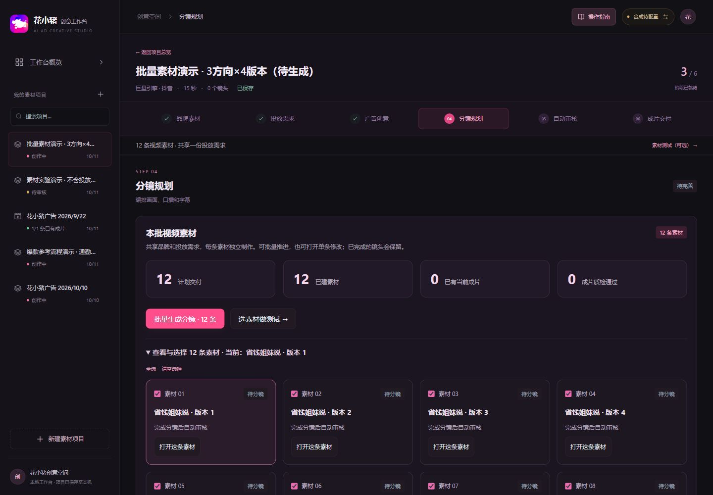
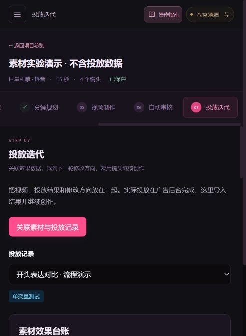
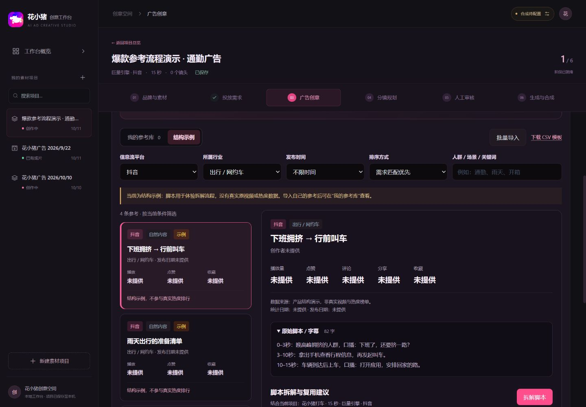
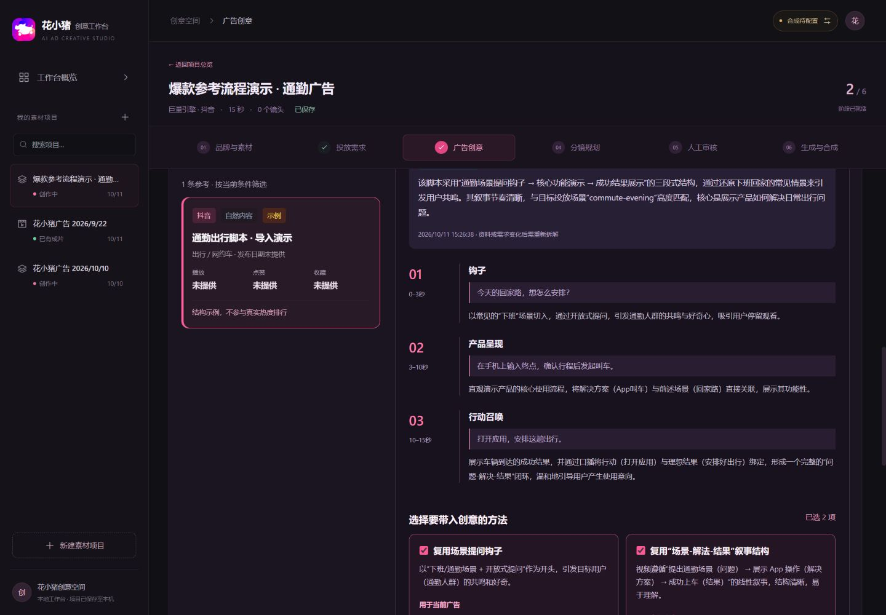
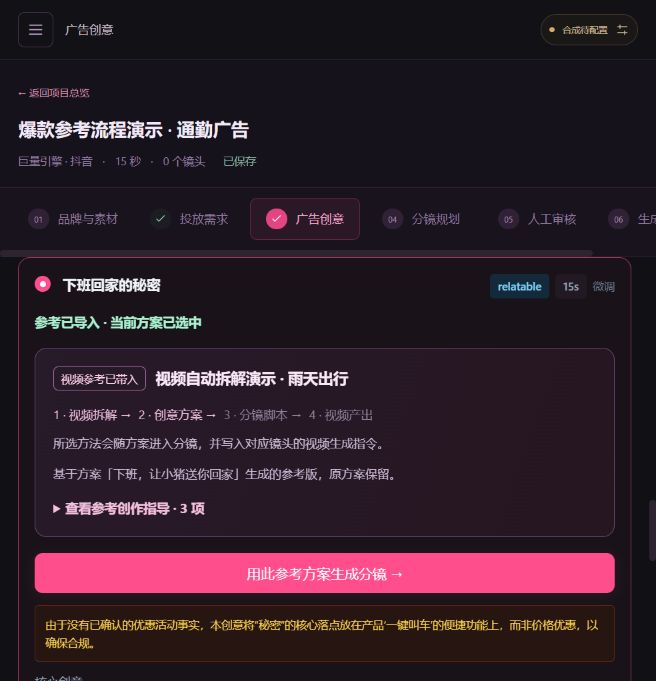
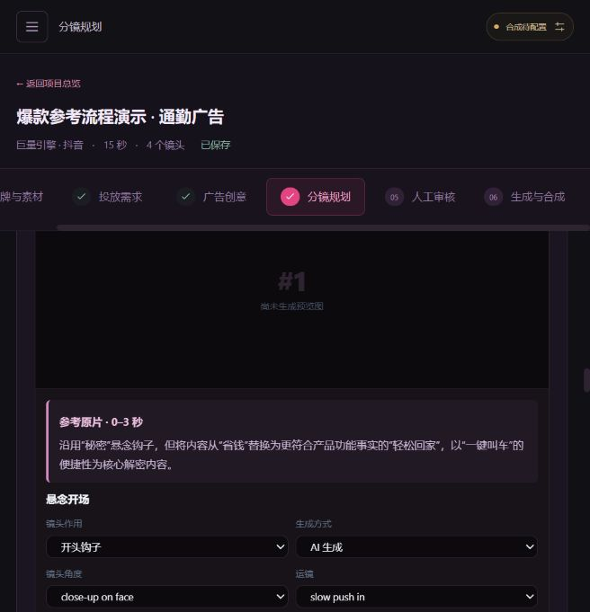

# AI Ad Creative Workbench

**简体中文** · [English](README.en.md)

**AI 广告创意与素材制作工作台：从投放需求出发，把创意、分镜、视频制作与成片审核串成一个可回看的流程。**

**一个项目 = 一条核心创意 + 多个视频版本**：先确认基础脚本，固定钩子机制、叙事结构、时长、卖点和 CTA，再选择人物、动作、镜头等允许变化项。在「视频制作」集中批量生成完整视频。[查看操作说明与能力边界](docs/experiments.md)。

### 完整操作录屏：从新建项目到一条 15 秒广告

约 3 分钟，跟随同一个项目完成 **事实与素材选择 → 投放需求 → 创意 → 分镜 → 自动审核与修复 → 视频生成 → 配音合成 → 播放下载**。每一步都有中文说明和实际点击提示。

https://github.com/user-attachments/assets/ea7da458-9990-423d-b896-ad58b3098b28

[下载完整录屏（MP4，约 7.3 MB）](assets/demos/workbench-workflow.mp4) · [操作步骤与视频章节](docs/walkthrough.md) · [查看这次生成的 15 秒成片](assets/demos/workflow-result.mp4)

> 这是一次实际操作记录：创意、分镜、首帧图与镜头均在本次新项目中调用模型生成，保留了审核发现问题后修改、复检的过程。模型与下载等待已剪短；操作部分用文字讲解，结尾附本次成片和原音轨。演示用于说明工作流，生成画面和素材版本仍需在正式投放前复核。

> 录屏展示此前的单条创作流程；当前顺序为“视频制作 → 自动审核与下载”，批量制作、规则来源和素材测试以最新截图及操作说明为准。

启动后，首页 **“90 秒了解流程”** 或顶部 **“操作指南”** 还提供 12 步可重播气泡导览，适合先熟悉页面。该导览使用独立示例，不修改项目或调用模型；[查看导览说明](docs/guide.md)。

> 当前以花小猪出行广告为案例，面向 10–20 秒竖屏信息流素材创作。以上及下方图片均截取自实际运行的工作台；实际项目、上传素材和生成视频保留在本地；仓库附带操作录屏、此次生成的演示成片、导览固定示例与压缩历史样片，新安装的工作台仍从空项目列表开始。

[功能与页面](#features) · [快速开始](#quick-start) · [模型配置](docs/configuration.md) · [部署与运行](docs/deployment.md) · [常见问题](docs/deployment.md#faq)

## 这个工作台能做什么

把分散在需求文档、提示词、素材文件和视频工具里的创作过程放进同一个项目。每一步保留上下文，方便回看、修改与继续制作。

- **同创意批量生产**：一份脚本框架扩展为多个视频版本，各自准备脚本、生成镜头、合成视频，再统一审核，支持暂停、续作与整批下载。
- **将需求变成可执行分镜**：从受众、场景、卖点和行动引导，逐步生成创意方向与镜头卡片。
- **让素材制作有依据**：关联产品事实与品牌素材，检查文案、镜头生成方式和口播时长，制作完成后由 Agent 对实际视频统一审核并给出修复建议。
- **完成生成与交付**：生成或回传镜头，叠加字幕、素材与配音，合成视频，下载成片、封面和结构化创作包。
- **让爆款参考贯穿创作**：上传视频自动拆解画面、声音与脚本，勾选参考点，一键导入方案并传递到分镜及视频生成指令。
- **制作与复盘 A/B 素材**：锁定开头或结尾镜头作为变量，独立制作版本，导入同区间 CSV 数据，计算 CTR/CVR/CPA，并把复盘建议带入下一轮。

渠道配置包含抖音、腾讯广告、快手和微信视频号的素材要求与安全区提示。目前支持手动 CSV 导入效果数据，**尚未接入广告账户发布、预算执行或自动效果回传**。

## 七个阶段，连接制作与效果迭代

| 阶段 | 在工作台中完成的事 | 主要产出 |
| --- | --- | --- |
| 01 品牌素材 | 在五个板块中选择、新增品牌与资料，设置整批共用规则 | 可复用的创作依据 |
| 02 投放需求 | 明确渠道、受众、场景、目标、卖点与 CTA | 结构化 Brief |
| 03 广告创意 | 从候选方案中选定一条核心创意 | 项目唯一创意方向 |
| 04 分镜规划 | 完成基础分镜，设置变化范围与版本数 | 共用框架与各版本脚本 |
| 05 视频制作 | 批量生成镜头，叠加字幕与配音，合成完整视频 | 多条完整视频 |
| 06 自动审核 | 检查品牌与平台规则、实际画面与声音，在同页下载通过素材 | 问题定位、审核报告与 ZIP 包 |
| 07 投放迭代 | 关联视频与效果数据，带着修改假设创建下一版 | 效果台账、修改建议、母版与迭代关系 |

审核与下载仍在同页完成；第七步将广告后台的效果数据带回创作，实际投放在广告平台执行。

## 功能与实际页面

### 一份需求，批量制作多条视频

资料直接在「品牌素材」阶段维护。一个项目选择一条核心创意；在分镜规划中确认基础脚本，设置固定钩子、允许变化项与视频数量。先在分镜规划准备各版本脚本，再批量制作成片，最后统一审核。「视频制作」用一张卡片展示一条完整视频，集中显示就绪条件、镜头进度、成片状态。已有内容会复用，单条失败不阻断其他版本。

在「投放迭代」关联已有视频，导入同口径 CSV 数据。台账展示素材与广告创意 ID、统计区间、CTR / CVR / CPA，以及可选成交金额与 ROAS。单条视频也能记录投放，不必先做 A/B 测试。规则建议显示数据依据；样本少、周期不同或视频已变更时不据此判断优胜。

点击「基于此版迭代」或带入建议，只修改开头或结尾 CTA，复用其他镜头。新版本仍在当前项目中，保留母版、效果快照、修改假设和关联测试。创建版本不调用生成模型，后续仅制作变化镜头，合成审核后再导入下一轮结果。

### 1. 五个板块，明确各类创作资料的位置

品牌基础信息记录产品定位、品牌色、Logo 与核心卖点；营销活动单独管理权益、条件和领取路径；素材资源库沿用原有分类；视觉设计集中展示画面、镜头、光照和制作规格；合规边界汇总表达与素材使用规则。资料共享，选用范围按项目保存，事实 ID 与原有素材引用保持兼容。

### 2. 把投放需求写清楚，再开始生成

按渠道、目标人群和出行场景组织 Brief，填写卖点、表达风格、目标时长与行动引导。渠道提示帮助创作者考虑竖屏构图、字幕和界面遮挡区域。

### 3. 先比较创意方向，再投入制作

围绕同一份需求生成候选方案，比较核心创意、前 3 秒钩子、用户痛点和事实依据，再选定一条。分镜规划中设置 2–60 个视频版本（包含基础版本），只在允许范围内变化；新增版本不会覆盖原有脚本与成片。版本差异不自动满足单变量实验条件。

### 爆款参考与脚本拆解

在“广告创意 → 爆款参考”上传 MP4 / MOV / WebM 视频（最大 14 MB），保存后由 Gemini 自动识别画面、字幕与声音，按时间码拆解脚本，提炼有观察依据的爆款点和参考方法。无需先手写脚本；也可继续导入文本或 CSV / JSON。

勾选钩子、结构、产品、CTA、视觉或声音等参考点，**一键导入创作方案**。可以生成新方案，也可以基于已有创意生成参考版；新方案自动选中，原方案保留。参考创作指导随方案进入分镜，每个相关镜头显示原片时间段与改写方式，并把对应的动作、运镜和节奏写入首帧及视频生成指令。

视频理解需要配置 Vertex Gemini；仅文本拆解也支持现有兼容接口。平台分享链接用于溯源，暂不自动抓取原片；上传原视频即可分析。爆款机制是待验证假设，推荐来自导入资料。已有分镜和成片保留，切换参考版方案后需重新生成分镜。完整操作见 [爆款参考指南](docs/inspiration.md)。

### 4. 每个镜头都可以编辑、预览和单独迭代

全局上下文记录人物、车辆、场景与视觉要求。分镜卡片分别管理镜头作用、画面描述、口播、字幕、时长和参考素材，可单独重新生成，减少修改一个镜头时的重复工作。

镜头提供三种制作方式：

| 方式 | 用途 |
| --- | --- |
| `ai` | 由模型生成场景与人物画面 |
| `overlay` | 生成底片后，用程序叠加字幕、Logo、优惠信息或其他素材 |
| `asset` | 使用已确认素材，例如产品录屏或已审核的画面 |

人物与场景描述、参考图可以帮助保持一致性；生成结果仍需逐镜检查。

### 5. 批量制作完整视频

准备好各版本脚本后，进入视频制作。生成前自动执行本地基础检查，阻止缺少素材、明确违规或不可执行的脚本进入生成；不再要求先完成一次 Agent 脚本审核。

支持镜头独立生成、回传和重试。合成自动加入字幕、品牌素材与配音，输出完整视频与封面。已有镜头会复用，单条失败不阻断其他版本。

### 6. 自动审核与打包下载

Agent 直接观看成片，统一检查品牌要求、投放平台规则、项目额外要求、创意一致性及画面声音质量。结果提供规则来源、具体时间段、观察依据和修复建议。修改脚本或制作设置并重新合成后，再复检当前成片；不自动重做收费镜头。

品牌规则只在「合规边界说明」维护；审核页自动载入，无须重复填写。缺少平台规则、模型不可用或证据不足时保持待处理。内置规则为附公开来源的基础条目，覆盖有限，工作台审核通过不代表媒体平台正式审核通过。

审核需要 Vertex Gemini，支持不超过 14 MB 的本地视频。审核通过的版本可直接在本页按所选或全部打包；不另设交付阶段。ZIP 包含视频、可用封面、文案 TXT、元数据与审核报告，最大 250 MB。未审核、未通过或已过期的版本不可打包。原有视频和历史报告保留，旧版结果需按新的成片审核范围复检。

## 快速开始

### 环境准备

| 依赖 | 说明 |
| --- | --- |
| Node.js | 建议使用 Node.js 22 或 24，需包含 npm |
| FFmpeg | 完整视频合成、字幕叠加和 Mock 占位视频需要；只浏览页面与体验创意流程时可暂不安装 |
| 中文字体 | 中文字幕需要；Windows 会尝试使用微软雅黑，Linux 可配置 Noto Sans CJK |
| 模型服务 | 可选；不配置凭证时，可以先体验 Mock 演示流程 |

### 1. 获取代码并安装依赖

~~~bash
git clone https://github.com/maipeici/ai-ad-creative-workbench.git
cd ai-ad-creative-workbench
npm ci
~~~

### 2. 创建本地配置文件

Windows PowerShell：

~~~powershell
Copy-Item .env.example .env
~~~

macOS / Linux：

~~~bash
cp .env.example .env
~~~

首次体验可保留示例中的空凭证。**已有 `.env` 时直接编辑，不要再次复制覆盖。**

### 3. 构建并打开工作台

~~~bash
npm run build
npm start
~~~

浏览器打开 [http://localhost:8787](http://localhost:8787)。首次启动会自动创建本地项目记录与媒体目录。

Windows 完成依赖安装后，也可以双击 `scripts/start-workbench.cmd`。启动脚本会检查本地服务；未运行时先构建页面、再启动服务并打开浏览器。

### 4. 创建第一条素材

1. 点击“新建素材项目”，在“创作基础”的五个板块中上传并选择自己的素材，核实产品事实。
2. 填写投放需求，生成并选定创意方案。
3. 生成分镜，检查口播、字幕、时长与参考素材。
4. 配置模型与 FFmpeg，批量生成镜头并合成视频；可用 Mock 或手动回传模式体验制作。
5. 进入自动审核，查看实际成片的审核结果；修复问题后复检，在同页打包下载通过的视频。

没有视频理解模型凭证时，成片自动审核无法完成，不会判定通过；生成前的本地基础检查仍可运行。创意与分镜使用演示数据，图片使用占位预览。Mock 视频在有 FFmpeg 时生成纯色占位片段，**不是真实 AI 视频**；没有 FFmpeg 时仅返回模拟状态。

## 配置与部署文档

- [模型与环境变量配置](docs/configuration.md)：Vertex AI、兼容接口、视频模式、配音与 FFmpeg。
- [部署与运行](docs/deployment.md)：本地开发、服务器常驻运行、数据备份、旧版升级与常见问题。
- [贡献说明](docs/CONTRIBUTORS.md)：项目维护与 AI 开发协作。

真实配置只放在根目录的 `.env`，仓库仅提交 `.env.example`。项目、素材与媒体保存在 `data/runtime/`，不会上传到 GitHub。首次启动从 `data/seed/` 初始化，后续启动保留用户修改。

## 技术与目录

前端使用 React、TypeScript、Vite 与 Tailwind CSS；后端使用 Node.js 与 Express。Sharp 处理图片，FFmpeg 处理视频，JSON 文件保存本地数据。

~~~text
src/
  client/                 前端源码、组件、创作阶段与样式
  server/                 服务端、模型适配、检查与数据读写
assets/
  public/brand/           页面 Logo 与图标
  public/demo/            导览中的压缩历史样片
  demos/                  README 演示视频与封面
  screenshots/            README 实际页面截图
config/
  business/               品牌规范、渠道与检查规则
  vite.config.ts          构建与开发服务配置
  tsconfig.json           TypeScript 配置
  tailwind.config.js      样式配置
  postcss.config.js       样式处理配置
data/
  seed/                   首次初始化使用的默认数据
  runtime/                本机项目与媒体，不上传
docs/                     部署、模型配置与贡献说明
scripts/
  start-workbench.cmd     Windows 双击启动入口
  start-workbench.ps1     构建、启动与打开浏览器
tests/                    环境配置与数据初始化测试
~~~

根目录保留 `package.json` 和 `package-lock.json`，统一使用 npm 管理依赖。

开发检查：

~~~bash
npm test
npm run typecheck
npm run build
~~~

运行开发模式：

~~~bash
npm run dev
~~~

开发页面为 [http://localhost:5173](http://localhost:5173)，后端默认为 [http://localhost:8787](http://localhost:8787)。
